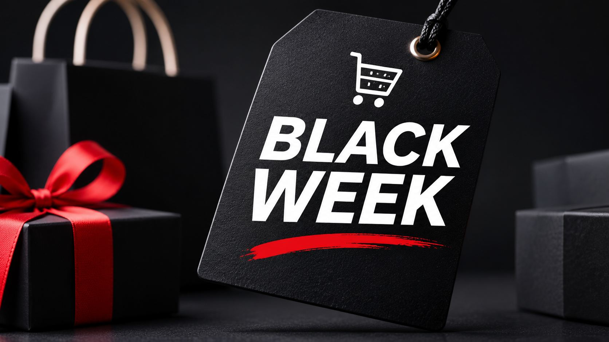
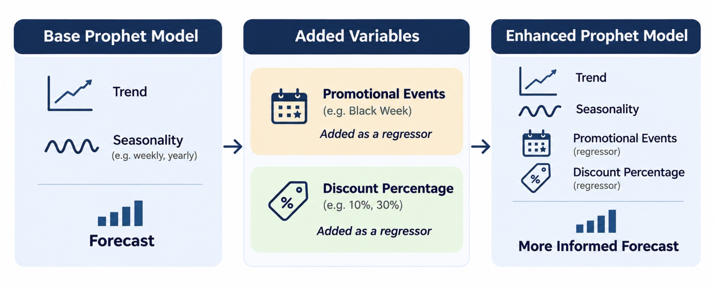
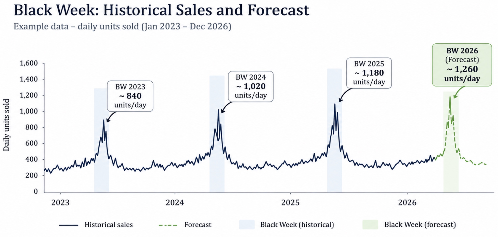

 
# Taking Sales Forecasting Further: Black Friday Demand Planning with Prophet

In my previous projects, I explored how to build and evaluate sales forecasts using Python and Prophet. I started with [Building My First Sales Forecast in Python with Prophet](https://github.com/Ibarca/Building-My-First-Sales-Forecast-in-Python-with-Prophet/blob/7d96a4d40f1ad34093ce58e52e6a35fa6e6f112e/README.md), where I explained how Prophet uses historical trends and seasonal patterns to predict future sales. I then took it a step further with [Forecast Validation with Prophet: Backtesting Using One Train-Test Split](https://github.com/Ibarca/Forecast-Validation-with-Prophet-Backtesting-Using-One-Train-Test-Split/blob/main/README.md), focusing on how to evaluate forecast accuracy using historical data.

While these exercises helped to understand both forecasting and model evaluation, I was still relying on Prophet's built-in seasonalities without considering additional factors that could influence demand. With Black Friday approaching, I thought it would be a good opportunity to build on what I've learned and explore **how to incorporate promotional events and discount information into Prophet**, this time applying the model to a practical e-commerce demand-planning problem. Let's go!

  

## 1. What Am I Adding This Time?

In e-commerce, demand is not only influenced by historical trends and seasonality. Promotional activities, discounts and other commercial factors can also be associated with changes in purchasing behaviour.

In my previous projects, I relied on Prophet's historical trend and seasonality components. This time, I want to take the next step by incorporating additional information into the model, specifically **promotional events and discount percentages**, and exploring whether this helps improve demand forecasts.

  

## 2. Understanding Regressors in Prophet

Regressors are additional variables that help a forecasting model capture relationships that may not be fully explained by historical trends and seasonality. In e-commerce, these could include pricing decisions, marketing campaigns, website traffic or external factors such as weather.

### Different Types of Regressors

Depending on the information they represent, regressors can take different forms:

| Type | Description | E-commerce examples |
|---|---|---|
| **Binary** | Indicates whether a condition is present (1) or absent (0) | Black Friday, promotional events |
| **Continuous numerical** | Represents a measurable quantity | Discount percentage, product price, marketing spend, temperature |
| **Discrete numerical** | Represents countable quantities | Number of active campaigns, advertising impressions |
| **Categorical** | Represents distinct categories without a natural order | Campaign type, marketing channel |
| **Ordinal** | Represents categories with a meaningful order | Promotion intensity: low, medium, high |

In Prophet, external regressors are added using `add_regressor()`. Since Prophet works with numerical inputs, categorical variables first need to be converted into numerical values, for example using binary indicators.

### Which Regressors Am I Using?

For this project, I'll focus on two regressors:

- **Promotional events:** A binary variable that takes the value `1` when a promotional event is taking place and `0` otherwise. This allows the model to capture demand patterns associated with events such as Black Friday, whose dates change every year.
- **Discount percentage:** A numerical variable representing the discount applied to each product, ranging from `0%` to `100%`. This allows Prophet to consider historical relationships between discount levels and sales.

Both variables will be included alongside Prophet's trend and seasonality components using `add_regressor()`.

> [!NOTE]
> **More regressors don't necessarily mean better forecasts.**
>
> Adding too many variables can introduce noise and increase the risk of **overfitting**, where the model learns patterns specific to historical data that don't generalize well to future demand. Highly correlated regressors can also make it difficult to interpret their individual effects.
>
> For this reason, I'll focus on two relevant regressors and use historical backtesting to evaluate whether they actually improve forecast accuracy.

## 3. What Can Regressors Actually Tell Us?

Imagine a product that sold **100 units during Black Week with a 10% discount**. If the retailer plans to offer a **30% discount** this year, should we expect the same demand?

Not necessarily. By including promotional events and discount percentages as regressors, Prophet can consider how sales have historically varied under different promotional conditions, provided there's enough relevant data to learn from.

> [!IMPORTANT]
> **Forecasting demand is different from measuring promotional impact.**
>
> Prophet can use promotional information to forecast expected demand, but it cannot necessarily determine how much additional demand a specific discount would cause. For this project, I'll focus on **predicting demand under planned promotional conditions**, rather than measuring the causal impact of discounts.

## 4. Project Objective

For this exercise, I'll use synthetic sales data from a fictional consumer-electronics retailer to forecast product-level demand for **Black Week 2026 (23–30 November)**.

Building on my previous Prophet projects, I want to explore whether incorporating **promotional events and planned discounts** can improve forecast accuracy compared with relying on historical sales patterns alone.

To evaluate this, I'll backtest three approaches against Black Week 2025:

- **Baseline Prophet:** Historical sales, trend and seasonality.
- **Prophet + Promotional Events:** Adding a binary indicator for promotional periods.
- **Prophet + Promotional Events + Discounts:** Incorporating discount percentages as an additional regressor.

I'll then use the available historical data and planned promotional conditions to generate the final Black Week 2026 demand forecast.

  

  <em>Figure 1. Conceptual illustration of Black Week sales history and the 2026 forecast. Values are illustrative, not actual model results.</em>

The focus of this project is on **incorporating promotional information into Prophet and evaluating its predictive value**, rather than revisiting forecasting fundamentals or extending the analysis into inventory planning.

For those interested in the fundamentals, I've covered them in my previous projects: [Building My First Sales Forecast in Python with Prophet](https://github.com/Ibarca/Building-My-First-Sales-Forecast-in-Python-with-Prophet/blob/7d96a4d40f1ad34093ce58e52e6a35fa6e6f112e/README.md), where I explored trends and seasonality, and [Forecast Validation with Prophet: Backtesting Using One Train-Test Split](https://github.com/Ibarca/Forecast-Validation-with-Prophet-Backtesting-Using-One-Train-Test-Split/blob/main/README.md), where I focused on evaluating forecast accuracy.

## 5. Understanding the Data

The dataset is organized into three CSV files, each serving a different purpose in the forecasting process.

| Dataset | Key Columns | Purpose |
|---|---|---|
| `sales_daily.csv` | `date`, `sku`, `units_sold`, `discount_pct`, `stockout_flag` | Historical sales and promotional pricing at product level |
| `products.csv` | `sku`, product information, lifecycle dates | Identifying products with sufficient historical data |
| `marketing_calendar.csv` | Event dates, event status, promotional indicators | Identifying historical and planned promotional periods |

The main dataset is `sales_daily.csv`, which contains the daily sales observations used to train Prophet. I'll combine it with the marketing calendar to identify promotional periods and use the product catalogue to select the SKUs included in the analysis.

Two variables are particularly important for this project: `discount_pct`, which captures the discount offered on a given day, and the promotional-event indicator derived from the marketing calendar. These will be introduced as external regressors to explore whether they improve forecast accuracy.

The `stockout_flag` will also play an important role, helping me identify sales observations that may not reflect actual customer demand.

> [!NOTE]
> **A limitation of synthetic data**
>
> The dataset is designed to simulate an e-commerce environment, but the relationships between sales, discounts and promotional events depend on the assumptions used to generate it. Any improvements in forecasting accuracy should therefore be interpreted as results of this simulated exercise rather than evidence that the same approach would perform equally well with real retail data.

### Handling Stockouts

One important thing I've learned when working with demand forecasting is that **sales don't always reflect actual demand**. For example, if a product runs out of stock, recorded sales will drop even though customers might still be interested in buying it. If I use these observations without accounting for stock availability, the model could interpret the lower sales as a drop in demand and underestimate future sales.

Fortunately, my dataset includes a `stockout_flag` that identifies days when products were out of stock. I'll use this information to exclude affected observations from model training and accuracy evaluation, while keeping the original sales data for historical reporting.

Of course, this approach doesn't recover the demand that was lost during stockouts, but it helps prevent the model from learning misleading patterns caused by limited product availability.

## 4. Preparing the Promotional Variables

The next step is to prepare the additional information that Prophet will use alongside historical sales.

### Promotional Events

Black Week takes place every year, but its dates change. Rather than expecting Prophet's yearly seasonality to capture this moving event automatically, I'll explicitly identify the historical and planned promotional periods.

For this exercise, I'll use Prophet's holiday functionality to represent Black Week dates. This allows the model to estimate an event effect separately from its regular seasonal patterns.

However, there are only three historical Black Weeks in the dataset, so the amount of information available to estimate this effect is limited.

### Discount Percentage

The second variable is the discount percentage applied to each product.

I'll add this as an external regressor using Prophet's `add_regressor()` functionality, allowing the model to estimate how sales have historically varied with discount levels.

For the final forecast, I'll provide the planned discounts for Black Week 2026. This is important because Prophet needs future values for external regressors when generating predictions.

One challenge is that discounts and promotional events often occur together. For example, a retailer may offer its largest discounts during Black Week, when demand is already unusually high. This makes it difficult to distinguish the contribution of the discount from the effect of the event itself.

For this reason, I'll interpret the discount regressor as a predictive variable rather than a measure of how much additional demand a particular discount will cause.

## 5. Building and Evaluating the Forecast

I'll train separate Prophet models for each of the 21 selected products, using daily sales history and the additional promotional information.

Before generating the Black Week 2026 forecast, I'll evaluate the approach using a historical backtest. The idea is to recreate a forecasting exercise for Black Week 2025 using only the sales history available before that event.

I'll compare three approaches:

| Approach | Variables |
|---|---|
| Baseline Prophet | Historical sales, trend and seasonality |
| Prophet + Events | Baseline plus promotional event indicators |
| Prophet + Events + Discounts | Promotional events plus discount percentage |

The comparison will help me understand whether the additional variables improve predictive performance. However, the main objective remains building a useful demand forecast, not identifying a universally superior model.

### Evaluating Accuracy

I'll evaluate the forecasts using **Weighted Absolute Percentage Error (WAPE)**, calculated as the sum of absolute forecast errors divided by the sum of observed sales.

I'll calculate WAPE using non-stockout observations to avoid evaluating the model against sales that may have been constrained by inventory availability.

For the discount-based backtest, I'll also distinguish between discounts that were known at the forecast cutoff and realized discounts. If only realized discounts are available, the evaluation will be conditional on those discounts and won't fully represent a real historical planning exercise.

The results will help me decide how much confidence to place in the additional variables before forecasting 2026.

**[Insert model comparison chart and backtesting results]**

## 6. Forecasting Black Week 2026

After evaluating the models, I'll use the available sales history through October 2026 and the planned promotional information to forecast demand for Black Week 2026.

The forecast will focus on expected units sold for each product, allowing me to compare anticipated demand with historical Black Week performance.

I'll look at three main questions:

- How many units are expected to sell across the selected products?
- Which products show the largest expected demand changes compared with 2025?
- Which products deserve closer attention when preparing inventory?

**[Insert total Black Week 2026 forecast]**

**[Insert product-level forecast comparison]**

The forecasts will represent estimates based on historical patterns and the planned promotional conditions, not guaranteed sales outcomes.

## 7. Translating the Forecast into Demand Planning

The most interesting part of this exercise is understanding how the forecasts could support commercial decisions.

For example, if a product is expected to experience significantly higher demand than in the previous year, a retailer may want to review whether sufficient inventory will be available. Similarly, products with previous Black Week stockouts may deserve additional attention.

However, forecasting demand is only one part of inventory planning. To calculate actual replenishment requirements, we would also need current stock levels, incoming deliveries, supplier lead times and potentially safety-stock targets.

Since this exercise focuses on demand forecasting, I'll use the results to identify potential planning priorities rather than calculate exact purchase orders.

**[Insert product-level planning recommendations based on actual results]**

## 8. Limitations

There are several limitations worth keeping in mind when interpreting the results.

First, the dataset is synthetic, so the findings don't represent the performance of a real retailer.

Second, the model has only three historical Black Weeks from which to learn promotional effects. This makes it difficult to draw strong conclusions about the relationship between discounts and demand.

Third, excluding stockout-affected observations avoids treating constrained sales as normal demand, but it doesn't estimate the sales that were lost.

Finally, the backtest focuses on Black Week 2025. Although this is useful for understanding the model's historical performance, additional evaluation periods would be needed to assess how reliably the approach performs across different years.

## 9. Key Takeaways

*To be completed after running the analysis.*

With this project, I want to move beyond forecasting based only on trends and seasonality and explore how additional commercial information can be incorporated into Prophet.

The main learning objective is to understand how promotional events and discount information affect the forecasting process, whether they provide useful predictive information and how the resulting forecasts can support demand planning.

Ultimately, I'm interested in connecting the technical side of forecasting with the commercial decisions that retailers need to make before major promotional events.

---

*All data used in this project is synthetic. The retailer and products are fictional.*
