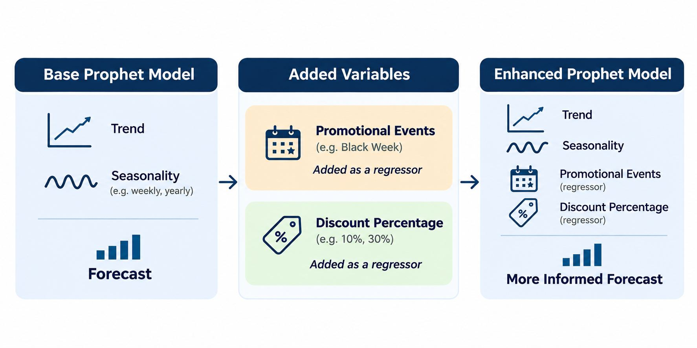

# Taking Sales Forecasting Further: Black Friday Demand Planning with Prophet

In my previous projects, I explored how to build and evaluate sales forecasts using Python and Prophet.

I started with [Building My First Sales Forecast in Python with Prophet](https://github.com/Ibarca/Building-My-First-Sales-Forecast-in-Python-with-Prophet/blob/7d96a4d40f1ad34093ce58e52e6a35fa6e6f112e/README.md), where I learned how Prophet identifies trends and seasonal patterns to predict future sales.

I then moved on to [Forecast Validation with Prophet: Backtesting Using One Train-Test Split](https://github.com/Ibarca/Forecast-Validation-with-Prophet-Backtesting-Using-One-Train-Test-Split/blob/main/README.md), where I explored how to evaluate forecast accuracy using historical data.

However, both exercises relied on Prophet's built-in seasonalities, without incorporating additional variables that could help explain changes in demand.

With Black Friday approaching, I thought it would be a good opportunity to take the next step and explore **how to incorporate promotional events and discount information into Prophet**, applying what I've learned to a practical demand-planning exercise.

  

## 1. What Am I Adding This Time?

In e-commerce, demand is not only influenced by historical trends and seasonality. Promotional activities and discounts can also have a significant impact.

This time, I'll introduce two additional elements:

- **Promotional events:** Flagging Black Week and other promotional periods so Prophet can learn their impact on demand, especially since Black Friday falls on different dates each year.
- **Discount percentage:** Adding the discount offered on each product as an external regressor to account for changes in promotional intensity.

### What Are Regressors?

Regressors are additional variables that help explain changes in the value we want to forecast.

For example, imagine a product that sold 100 units during Black Week last year with a 10% discount. This year, the retailer plans to offer a 30% discount.

Should we expect the same demand? Probably not. But how much additional demand could the higher discount generate?

By including discount percentage as a regressor, Prophet can use this information alongside historical sales patterns.

Of course, adding more variables doesn't necessarily improve forecast accuracy. That's something I'll also evaluate.

> [!IMPORTANT]
> **More regressors don't always mean better forecasts.**
>
> Adding relevant variables can improve accuracy by helping Prophet explain changes in demand. However, too many regressors can lead to **overfitting**: the model starts learning noise rather than meaningful patterns.
>
> This can make forecasts less reliable on new data, especially when historical observations are limited. That's why I'll evaluate whether the additional variables actually improve accuracy before using them for Black Week 2026.

## 2. The Objective

For this exercise, I'll use synthetic data from a fictional consumer-electronics retailer to forecast product-level demand for **Black Week 2026 (23–30 November)**.

This project builds on two previous exercises:

1. [Building My First Sales Forecast in Python with Prophet](https://github.com/Ibarca/Building-My-First-Sales-Forecast-in-Python-with-Prophet/blob/7d96a4d40f1ad34093ce58e52e6a35fa6e6f112e/README.md), where I explored the fundamentals of forecasting with Prophet.
2. [Forecast Validation with Prophet: Backtesting Using One Train-Test Split](https://github.com/Ibarca/Forecast-Validation-with-Prophet-Backtesting-Using-One-Train-Test-Split/blob/main/README.md), where I learned how to evaluate forecast accuracy using historical data.

This time, I want to go a step further by incorporating **promotional events and planned discounts** into Prophet and exploring how the resulting forecasts could support inventory planning.

Before forecasting 2026, I also want to answer one question: **Does adding promotional information actually improve forecast accuracy, and if so, by how much?**

To find out, I'll backtest the approach against Black Week 2025, comparing a basic Prophet model with versions that include promotional events and discount information.

Rather than revisiting forecasting fundamentals or evaluation methods, I'll focus on introducing these additional variables, understanding their impact and translating the final forecast into practical demand-planning insights.

*All data used in this project is synthetic. The retailer and products are fictional.*

## 1. The Challenge

Black Week creates demand patterns that are difficult to estimate from historical sales alone.

Two factors can distort the picture:

- **Stockouts:** Zero sales may mean that a product was unavailable, not that customers did not want it.
- **Changing discounts:** The same product may have a different discount from one year to the next, affecting demand.

A useful forecast therefore needs to account for the event itself and the promotion planned for the forecast period.

## 2. The Approach

The notebook builds forecasts for products with sales history across all three previous Black Weeks and compares a series of increasingly informed models.

1. Explore daily sales, product information and the marketing calendar.
2. Remove sold-out days from model training so unavailable products do not teach the model that demand was zero.
3. Use Prophet to model historical sales patterns.
4. Add Black Week and other promotions as event effects.
5. Add the planned discount as an explanatory variable (regressor).
6. Backtest the approaches by pretending the forecast was made on 12 October in 2024 and 2025.
7. Compare forecasts with actual sales using weighted absolute percentage error (WAPE).
8. Combine the model forecast with the simple "same as last year" benchmark.

The forecast for 2026 uses sales data through **12 October 2026** and the discounts in the 2026 promotion plan.

## 3. Results

The backtest highlights that knowing when Black Week takes place matters more than adding every available variable. Discount information also helps, particularly when the planned discount differs from previous years. Other promotion events add little in this particular test.

| Method | 2024 WAPE | 2025 WAPE |
|---|---:|---:|
| Same as last year | 22% | 11% |
| Prophet with event, promotion and discount information | 15% | 12% |
| Average of both approaches | 18% | 8% |

The combined approach is used for the final planning forecast. It balances the familiar year-on-year benchmark with a model that can account for event and discount information.

## 4. Black Week 2026 Forecast

For the 21 established products included in the analysis:

| Planning measure | Units |
|---|---:|
| Forecast demand | **3,793** |
| Low planning estimate | 2,713 |
| High planning estimate | 4,511 |
| Black Week 2025 sales for the same products | 3,510 |

The notebook also produces:

- A product-level forecast and planning range.
- A comparison with the previous year's sales and discounts.
- Notes highlighting products that sold out during the previous Black Week or have a changed planned discount.
- An indicative daily demand profile to help think about operational workload.

The low and high estimates are historical error-based planning ranges, not guaranteed outcomes.

## 5. Data

The project uses four input files:

| File | Description |
|---|---|
| `sales_daily.csv` | Daily units sold, discount and stockout flag by product |
| `products.csv` | Product catalogue |
| `marketing_calendar.csv` | Promotional events from 2023 to 2026 |
| `promotion_plan_2026.csv` | Planned discounts for the remainder of 2026 |

## 6. Tools & Technologies

- Python
- pandas and NumPy
- Matplotlib
- Prophet
- Jupyter Notebook

## 7. Limitations

- **Synthetic data:** The results illustrate a method; they are not evidence of performance for a real retailer.
- **Limited history:** The analysis has at most three previous Black Weeks, with only two backtesting years.
- **Stockout treatment:** Sold-out days are excluded from model training, but lost demand is not explicitly estimated.
- **Discount assumptions:** The model learns discount effects from historical observations. Discounts outside the historical range are uncertain.
- **Product scope:** Newer products without sufficient Black Week history require a different forecasting approach.
- **Promotional coverage:** The marketing calendar is shop-wide and may not mean every product participates in every promotion.

## 8. Key Takeaway

Demand planning is not just about extrapolating last year's sales. It requires understanding what makes the forecast period different: event timing, promotional mechanics and product availability.

The goal is to turn that context into a forecast that supports better inventory and operational decisions.

---

*This is an independent portfolio project using synthetic data. It is intended as a practical demonstration of demand-planning and commercial-analytics methods.*
